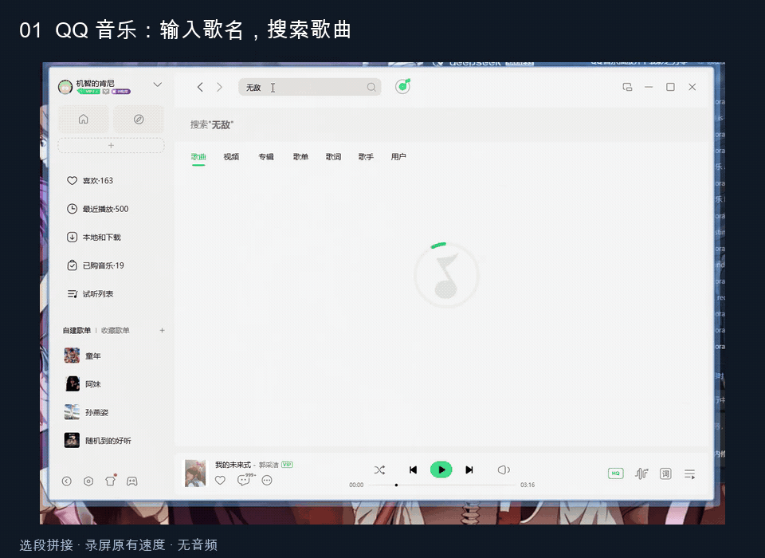

# DSH CUA — Windows Computer Use for DeepSeek Harness

[简体中文](README.md) | **English**

A Windows desktop and browser automation plugin for **DeepSeek Harness (DSH)**.
DSH plans each task. The runtime provides structured DOM/UIA observations,
model-visible image attachments, desktop actions and readback. The installable package is named `dsh-doraemon`.

<a href="https://www.bilibili.com/video/BV1L9xe6sEDi/">
  <picture>
    <source srcset="https://raw.githubusercontent.com/Mrkennyhungry/dsh-cua/main/docs/images/demo.gif" type="image/gif">
    
  </picture>
</a>

*72 seconds of selected actions at their original recorded speed, with idle waits removed and action captions below the screen. Click to watch the full demo.*

**[Watch the cross-app demo on Bilibili](https://www.bilibili.com/video/BV1L9xe6sEDi/)**
— QQ Music → Steam → Bilibili → QQ. The author reports approximately 6.5 minutes
and CNY 0.36 for this particular run; these are not general performance guarantees.

The demo starts music, initiates a game download, searches for a tutorial, and sends
the link to the author's own QQ account. It shows recovery from UI mistakes and
disk selection, not just successful clicks.

**[快速上手 / Quick start](QUICKSTART.md)** · [Data boundary](docs/data-boundary.md)
· [Report a problem](https://github.com/Mrkennyhungry/dsh-cua/issues)

Thanks to [LINUX DO](https://linux.do/) for the community space to share and discuss open-source projects.


## How it works

| Tool | Purpose |
| --- | --- |
| doraemon_open | Open an app, URL or target and return its initial observation |
| doraemon_observe | Discover targets, read DOM/UIA, query elements and text, request images or local vision |
| doraemon_act | Execute 1–8 ordered actions using observation refs or image frames and return readback |
| doraemon_wait | Wait for a condition and return an operation handle when needed |
| doraemon_status | Read the runtime version, backends and operation progress |
| doraemon_stop | Cancel one operation or the current session's active operations |

DSH supplies the model configuration. Images enter model requests through native attachments.
DOM/UIA provide structured information first. OCR and YOLO load on demand, and default caption requests are zero.
Input, selection, uploads, windows and tabs share the runtime. Use act.expect with transient=true for action-triggered brief messages.

## Install the plugin

Requires Windows 10/11, Node.js >=22, DeepSeek Harness and uv on PATH. Bootstrap provisions Python 3.11. Microsoft Edge is the default browser.

1. Install dsh-doraemon through DSH Plugins → Add plugin or plugin_manager install_bundle. Development builds can use a local directory or archive.
2. Open PowerShell in the installed plugin directory and run bootstrap.

```powershell
.\scripts\bootstrap.ps1
```

3. Reload the plugin, create a new DSH session and confirm all six tools appear. Call doraemon_status.
4. Open a test app or page, inspect the initial observation, perform an action and verify the returned content.

Optional vision dependencies and existing weights can be installed separately.

```powershell
.\scripts\bootstrap.ps1 -Vision -WeightsDir 'C:\existing-models\weights'
```

WeightsDir contains icon_detect\model.onnx. Existing runtime weights remain available. RapidOCR can use its packaged models.
With DSH_DESKTOP_BROWSER=chromium, install the matching Playwright Chromium browser first using the runtime Python.

### First run on a new machine

Bootstrap creates %LOCALAPPDATA%\dsh-desktop\venv. Logs and the operation journal use stateDir, defaulting to %USERPROFILE%\.dsh\desktop.
Explicit pythonPath and homeDir can select an existing setup. The elevated-task installer supports hosts requiring elevated desktop input.
Existing local permissions are used during execution.

New persistent browser profiles use stateDir\browser. Existing homeDir\web_profile_edge or web_profile directories take precedence.
Cookies and site settings survive runtime restarts. First login, verification challenges and expired credentials may require user interaction.
Explicit browser connections use open.connect with a CDP URL or configured.

### Optional companion

Enable commandFeedback in the DSH plugin configuration UI. Build the net10.0-windows companion with a compatible .NET SDK.

```powershell
.\scripts\build-companion-ui.ps1
```

For read-only installations, build in a writable copy and set DSH_DESKTOP_COMPANION_UI to the executable.
Ctrl+Alt+W opens the scope picker, Ctrl+Alt+Q stops input, and Ctrl+Alt+M toggles the character.
[Companion guide](docs/commander-mode.md)

## Data and recovery

DSH sends selected image attachments and tool text to its configured model provider. Local OCR and YOLO process pixels on this machine.
Operation status retains completed_steps, uncertain_step and worker_running for cancellation and partial completion.
Verify business results through readback before continuing.
[Data boundary](docs/data-boundary.md)

Historical Agent, workbench, IM, WeCom and cron entry points are retained in the source compatibility boundary.
Migration instructions include original data locations, profile backup and recovery from an independent checkout.
[Upgrade to 0.5](docs/MIGRATION-0.5.md)

The telemetry history for versions 0.4.5–0.4.7 and its removal in 0.4.8 remain documented in the data-boundary guide.
