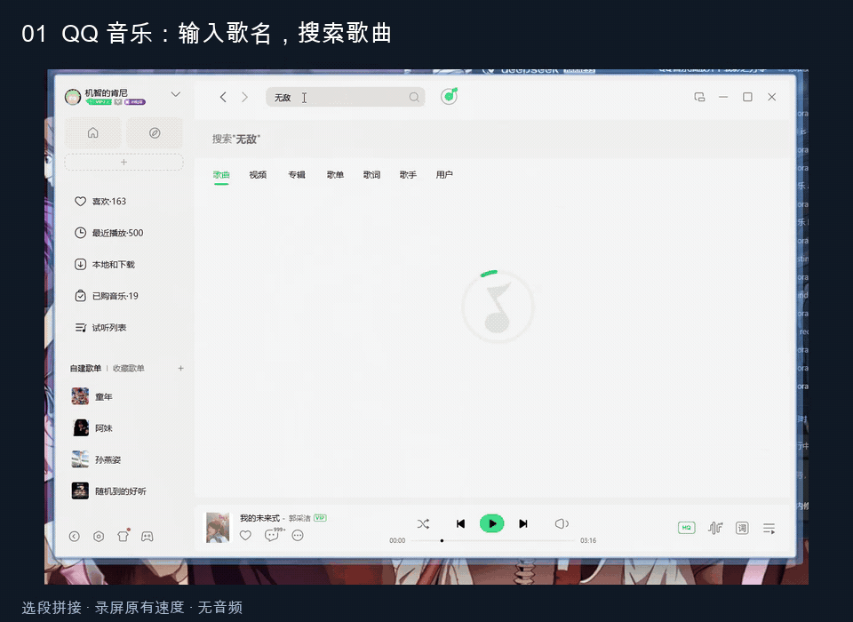

# DSH CUA — Windows 桌面自动化插件

**简体中文** | [English](README.en.md)

让 **DeepSeek Harness（DSH）操作 Windows 桌面应用与浏览器**。
由 DSH 规划任务，插件统一提供 DOM/UIA、图片观察、桌面输入与结果读回。OCR 和 YOLO 按需加载。

Windows computer-use plugin for DeepSeek Harness, combining UI Automation (UIA), local OCR, window binding, browser automation and visual grounding.

<a href="https://www.bilibili.com/video/BV1L9xe6sEDi/">
  <picture>
    <source srcset="https://raw.githubusercontent.com/Mrkennyhungry/dsh-cua/main/docs/images/demo.gif" type="image/gif">
    
  </picture>
</a>

*72 秒操作选段拼接，片段保持录屏原有速度并省略无操作等待；画面下方字幕标出当前动作。点击动图观看完整实测。*

**[观看完整实测：QQ 音乐 → Steam → B 站 → QQ](https://www.bilibili.com/video/BV1L9xe6sEDi/)**

[快速安装](#快速安装) · [完整安装参考（English）](README.en.md#install-the-plugin) · [数据边界](docs/data-boundary.md) · [反馈问题](https://github.com/Mrkennyhungry/dsh-cua/issues)

## 实测：一句话，完成多个软件里的任务

> 打开 QQ 音乐播放《无敌》；去 Steam 家庭库找《影之刃零》，有就开始下载；再去 B 站找相关教程，把链接通过 QQ 发给我自己，顺便留句话。

这次任务约 **六分半，花费 0.36 元**（作者本次运行记录，非通用性能基准）。演示保留了判断与纠错：识别 Steam 界面、根据磁盘剩余空间选择安装位置、处理独立协议窗口、筛选教程并发送链接。

下载启动后，Agent 继续搜索教程和发送消息；不需要等待整个游戏下载完成。演示中的“完成下载任务”指**已开始下载**。


## 六个统一工具

| 工具 | 用途 |
| --- | --- |
| doraemon_open | 打开应用、网页或已有 target，返回初始观察，可显式连接已有浏览器 |
| doraemon_observe | 枚举目标、读取 DOM/UIA、查询正文和元素，按需附带图片或局部视觉信息 |
| doraemon_act | 使用 observation、ref 或 frame 定位，顺序执行 1–8 步动作并读回 |
| doraemon_wait | 等待明确条件，慢操作返回 operation_id |
| doraemon_status | 查询版本、后端及操作的完成、部分执行和 worker 状态 |
| doraemon_stop | 取消指定操作或当前会话的活动操作 |

图片通过 DSH 的原生附件进入当前模型请求。主模型和提供方沿用 DSH 设置，默认 caption 请求数为 0。DOM/UIA 优先返回结构化信息，首次观察带图，语义稳定时减少重复图片。输入、选择、附件、窗口与标签操作共用统一 runtime。动作触发的短提示通过 act.expect 的 transient 监听读取。

## 快速安装

需要 Windows 10/11、Node.js >=22、DeepSeek Harness 与已加入 PATH 的 uv。基础运行使用 Python 3.11 和已安装的 Microsoft Edge。

1. 在 DSH 的 Plugins → Add plugin 中安装 dsh-doraemon。开发验收使用本地目录或打包文件，公开版本也可使用仓库的 Git 安装标识。
2. 在安装包目录打开 PowerShell，执行以下命令。安装脚本将 Python 和运行数据放到用户 runtime 目录。

```powershell
.\scripts\bootstrap.ps1
```

3. 重载插件，创建新的 DSH 会话，确认六个工具可见并调用 doraemon_status。
4. 让 DSH 打开测试网页或记事本，读取初始观察，执行输入并核对内容。

可选视觉安装及权重复用如下。WeightsDir 应包含 icon_detect\model.onnx。

```powershell
.\scripts\bootstrap.ps1 -Vision -WeightsDir 'C:\existing-models\weights'
```

已有安装继续使用原来的权重和 profile。新浏览器 profile 位于 stateDir\browser，兼容复用 homeDir\web_profile_edge 或 web_profile。登录、Cookie 和站点设置随 profile 保留。首次登录、验证码和登录失效可由用户在专用浏览器中处理。

完整步骤和数据路径见快速上手及迁移说明。[QUICKSTART.md](QUICKSTART.md) · [0.5 迁移](docs/MIGRATION-0.5.md)

## 可选窗口作用域选择器

在插件配置界面开启 commandFeedback，并在插件目录构建 companion。项目目标为 net10.0-windows，需要兼容的 .NET SDK。

```powershell
.\scripts\build-companion-ui.ps1
```

构建产物默认位于插件目录的 .runtime\companion-ui。源码目录只读时，可在可写副本中构建并通过 DSH_DESKTOP_COMPANION_UI 指向其可执行文件。Ctrl+Alt+W 呼出选择器，Ctrl+Alt+Q 紧急停止输入，Ctrl+Alt+M 切换角色显示。[指挥员说明](docs/commander-mode.md)

## 数据与结果

截图和结构化内容可通过 DSH 交给配置的模型。OCR/YOLO 在本机执行。stateDir 默认是 %USERPROFILE%\.dsh\desktop，包含日志和操作 journal，homeDir 默认是 %LOCALAPPDATA%\dsh-desktop。历史内置 Agent、工作台、IM、WeCom 和 cron 的旧入口及数据恢复路径见迁移文档。[数据边界](docs/data-boundary.md) · [迁移与恢复](docs/MIGRATION-0.5.md)

桌面坐标输入使用真实鼠标。长操作通过 operation_id 查询，取消后应同时检查 worker_running、completed_steps 和 uncertain_step，再观察现场确认结果。业务完成由明确读回验证。

0.4.5–0.4.7 的遥测历史及 0.4.8 的移除记录保留在数据边界文档。

## 反馈与参与

反馈请提供 Windows、DSH 和插件版本、目标软件、复现步骤与实际结果。[Issues](https://github.com/Mrkennyhungry/dsh-cua/issues)

感谢 LINUX DO 提供开源项目交流空间。[LINUX DO](https://linux.do/)

本项目使用 MIT License。[LICENSE](LICENSE)
